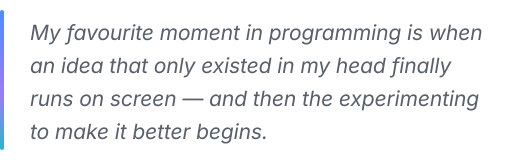

 

I'm a full stack developer who enjoys the whole journey of building software — from untangling a problem to shipping something people can actually use. Lately most of my time goes into AI and automation: bringing LLMs into real applications, building agents, and finding ways for software to take repetitive work off people's plates.

 

###  &nbsp;About me 

 &nbsp;**AI & Intelligent Systems** &nbsp;·&nbsp; Generative AI, AI agents, LLM integrations, automation 
 &nbsp;**Programming Languages** &nbsp;·&nbsp; C, C++, C#, Java, Python, JavaScript, SQL 
 &nbsp;**Frontend** &nbsp;·&nbsp; React, HTML, CSS 
 &nbsp;**Backend** &nbsp;·&nbsp; .NET, ASP.NET Core, Node.js, Express.js, FastAPI 
 &nbsp;**Databases** &nbsp;·&nbsp; MySQL, MongoDB, PostgreSQL, Firebase Realtime Database 
 &nbsp;**Platforms & Tools** &nbsp;·&nbsp; Git, GitHub, Docker, Firebase, Vercel 
 &nbsp;**Currently Learning** &nbsp;·&nbsp; software engineering, problem-solving and emerging technologies

 

###  &nbsp;Hobbies & interests 

- **Exploring new technologies** — and figuring out how they work under the hood
- **Solving programming problems** — the trickier, the better
- **Experimenting with AI and automation** — in small side projects
- **Brainstorming creative solutions** — to everyday problems
- **Stepping away from the keyboard to recharge** — good ideas often show up during the breaks

 

###  &nbsp;My approach 

 &nbsp;**Learn by building** — the fastest way to understand something is to make it. 
 &nbsp;**Stay curious** — there is always a better way waiting to be found. 
 &nbsp;**Improve through experimentation** — try, measure, adjust, repeat. 
 &nbsp;**Value collaboration and continuous learning** — the best work rarely happens alone.

 

###  &nbsp;Fun fact 

<picture>
  <source media="(prefers-color-scheme: dark)" srcset="./assets/sections/quote-dark.svg">
  <source media="(prefers-color-scheme: light)" srcset="./assets/sections/quote-light.svg">
  
</picture>
