 

I'm a full stack developer who enjoys the whole journey of building software — from untangling a problem to shipping something people can actually use. Lately most of my time goes into AI and automation: bringing LLMs into real applications, building agents, and finding ways for software to take repetitive work off people's plates.

 

## About me

 &nbsp;**AI & Intelligent Systems** &nbsp;·&nbsp; Generative AI, AI agents, LLM integrations, automation 
 &nbsp;**Programming Languages** &nbsp;·&nbsp; C, C++, Java, Python, JavaScript, SQL 
 &nbsp;**Web Development** &nbsp;·&nbsp; React, HTML, CSS, Node.js, Express.js, FastAPI 
 &nbsp;**Platforms & Tools** &nbsp;·&nbsp; Git, GitHub, Docker, Firebase, Vercel 
 &nbsp;**Databases** &nbsp;·&nbsp; MySQL, MongoDB, PostgreSQL, Firebase Realtime Database 
 &nbsp;**Currently Learning** &nbsp;·&nbsp; software engineering, problem-solving and emerging technologies

 

## Hobbies & interests

- Exploring new technologies and figuring out how they work under the hood
- Solving programming problems — the trickier, the better
- Experimenting with AI and automation in small side projects
- Brainstorming creative solutions to everyday problems
- Stepping away from the keyboard to recharge; good ideas often show up during the breaks

 

## My approach

**Learn by building** — the fastest way to understand something is to make it. 
**Stay curious** — there is always a better way waiting to be found. 
**Improve through experimentation** — try, measure, adjust, repeat. 
**Value collaboration and continuous learning** — the best work rarely happens alone.

 

## Fun fact

> My favourite moment in programming is when an idea that only existed in my head finally runs on screen — and then the experimenting to make it better begins.
