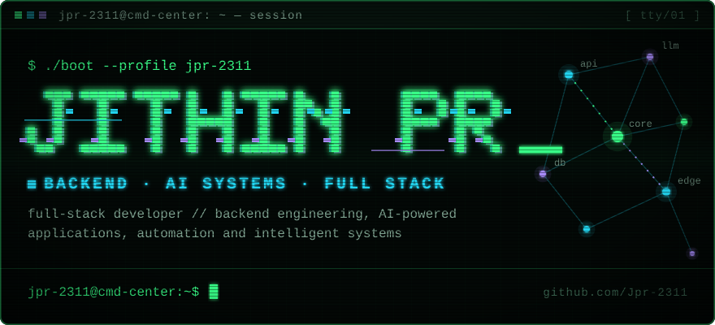
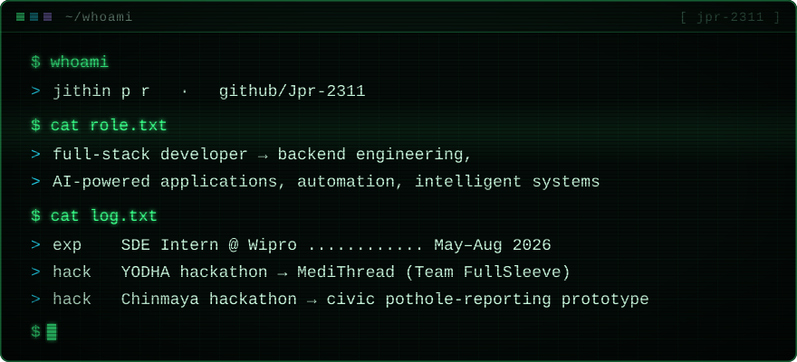
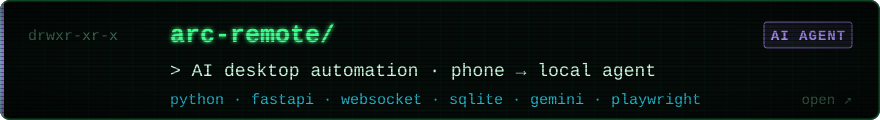
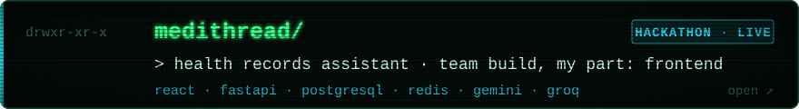
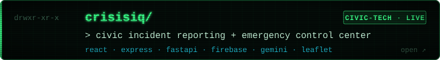
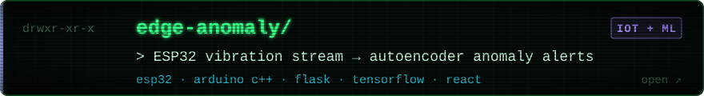
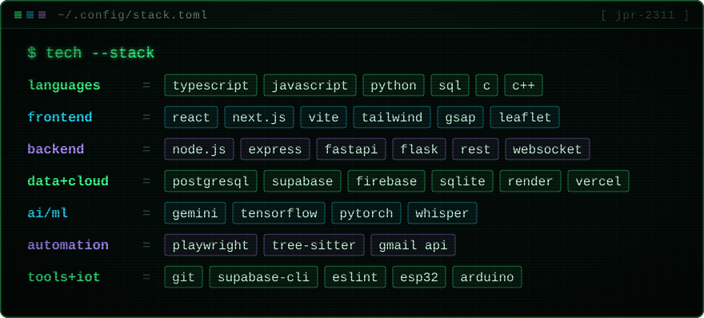
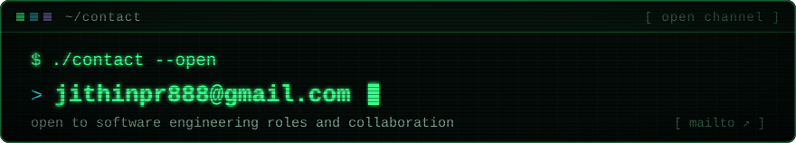

<code>live</code> <a href="https://medithread.onrender.com/login">medithread ↗</a> · <a href="https://crisisiq-frontend-233w.onrender.com/">crisisiq ↗</a> &nbsp;&nbsp; <code>more</code> <a href="https://github.com/Jpr-2311/SalesAgents-AI-Assignment">voice-agent design</a> · <a href="https://github.com/Jpr-2311/ssmp">SIC assembler in C</a> · <a href="https://github.com/Jpr-2311?tab=repositories">all repos ↗</a>

<code>$ echo $EMAIL</code> → <a href="mailto:jithinpr888@gmail.com">jithinpr888@gmail.com</a>
