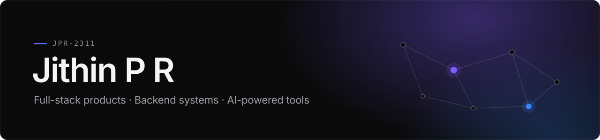

<picture>
  <source media="(prefers-color-scheme: dark)" srcset="./assets/banner-dark.svg">
  <source media="(prefers-color-scheme: light)" srcset="./assets/banner-light.svg">
  
</picture>

 

**Full-Stack Developer · Backend Engineering · AI-Powered Applications**

I build full-stack products end to end — database rules, typed APIs and the interface on top — with a focus on backend systems and AI-powered tools.

[jithinpr888@gmail.com](mailto:jithinpr888@gmail.com) &nbsp;·&nbsp; [Work](#selected-work) &nbsp;·&nbsp; [Stack](#stack) &nbsp;·&nbsp; [Highlights](#highlights)

 

## Selected work

### OneForAll
Engineering intelligence platform that links teams, requirements and tasks to the exact commits that ship them.

- Multi-tenant hierarchy enforced by PostgreSQL Row Level Security
- Repository ingestion with HMAC-signed manifests and credential-file exclusion
- Interactive code graph built from tree-sitter analysis of TS, JS, Python and Java
- GitHub and Jira integrations with AES-256-GCM token encryption

`Next.js` `React` `TypeScript` `Supabase` `PostgreSQL` &nbsp; **[Repository ↗](https://github.com/Jpr-2311/OneForAll)**

 

### ARC Remote
Control your desktop from your phone: send a plain-language request, and a local agent carries it out and reports back.

- One-time pairing code, bearer-token auth, command allowlist and audit log
- Jobs stream live over WebSocket and pause for clarification or confirmation
- My part: Windows control layer, mobile client, intent routing and email automation

`Python` `FastAPI` `WebSocket` `SQLite` `Gemini` `Playwright` &nbsp; **[Repository ↗](https://github.com/Jpr-2311/ARC-REMOTE-DA)**

 

### MediThread
Turns photos of prescriptions and lab reports into one readable health record, explained in English and Malayalam.

- Drug-interaction and danger-sign checks across the whole record
- Telegram dose reminders and a doctor's voice console that drafts SOAP notes
- Built at the YODHA hackathon with Team FullSleeve; my part: the frontend redesign

`React` `FastAPI` `PostgreSQL` `Redis` `Gemini` `Groq` &nbsp; **[Repository ↗](https://github.com/Jpr-2311/YODHA-HACK)** · **[Live demo ↗](https://medithread.onrender.com/login)**

 

### CrisisIQ
Civic incident reporting: citizens report road damage with a photo and location, and officers and an emergency control center act on it.

- Three services: React frontend, Express API gateway, FastAPI AI service
- Nearby duplicate reports merged by distance; live incident map and hospital capacity view
- Gemini copilot that answers control-center questions over live Firebase data

`React` `Express` `FastAPI` `Firebase` `Gemini` `Leaflet` &nbsp; **[Repository ↗](https://github.com/Jpr-2311/Emergency)** · **[Live demo ↗](https://crisisiq-frontend-233w.onrender.com/)**

 

### Edge Vibration Anomaly Detection
Catches abnormal vibration as it happens: an ESP32 streams accelerometer data to an autoencoder that flags anomalies live.

- Keras autoencoder trained on a recorded baseline, scoring 100-sample windows by reconstruction error
- Worker and supervisor dashboards with an audible alarm; the device buzzer sounds on alerts

`ESP32` `Arduino C++` `Flask` `TensorFlow` `React` &nbsp; **[Repository ↗](https://github.com/Jpr-2311/miniProjectNew)**

 

Also: [voice-agent design](https://github.com/Jpr-2311/SalesAgents-AI-Assignment) · [SIC assembler and loaders in C](https://github.com/Jpr-2311/ssmp) · [ARC landing page](https://github.com/Jpr-2311/ARC) · [all repositories ↗](https://github.com/Jpr-2311?tab=repositories)

 

## Stack

**Languages** &nbsp; `TypeScript` `JavaScript` `Python` `SQL` `C` `C++` 
**Frontend** &nbsp; `React` `Next.js` `Vite` `Tailwind CSS` `GSAP` `Leaflet` 
**Backend and APIs** &nbsp; `Node.js` `Express` `FastAPI` `Flask` `REST` `WebSocket` 
**Databases and Cloud** &nbsp; `PostgreSQL` `Supabase` `Firebase` `SQLite` `Render` `Vercel` 
**AI/ML and Automation** &nbsp; `Gemini API` `TensorFlow` `PyTorch` `Whisper` `Playwright` `tree-sitter` 
**Tools and Embedded** &nbsp; `Git` `Supabase CLI` `ESLint` `ESP32` `Arduino`

 

## Highlights

- **Software Development Engineer Intern**, Wipro · May – Aug 2026
- **YODHA Hackathon** · built MediThread with Team FullSleeve
- **Chinmaya Hackathon** · idea-phase prototype for citizen pothole reporting

 

---

Open to software engineering roles and collaborations · [jithinpr888@gmail.com](mailto:jithinpr888@gmail.com)
